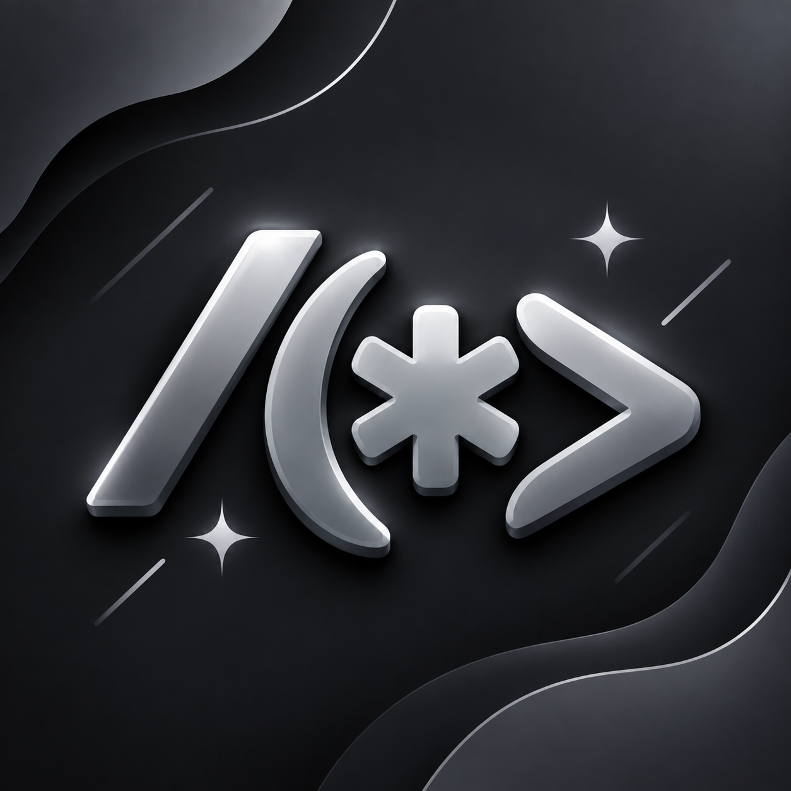

# Anti IDE 💻 - Clon de IntelliJ IDEA / NetBeans para PC



IDE de escritorio estilo **Darcula** hecho con **Electron + Monaco Editor** (el mismo editor de VS Code).
Soporta **todos los lenguajes** vía compiladores locales.

## Funciones v1 (igualito a IntelliJ)
- [x] Menú File/Edit/View/Run/VCS como IDEA (desplegables reales)
- [x] Barra Run ▶ verde + Build 🔨 + ☕ JDK + Terminal
- [x] Explorador de proyectos, crear/renombrar/borrar archivos
- [x] Pestañas, breadcrumb, minimap, autocompletado, Ctrl+S, Ctrl+P, Shift+F10
- [x] Structure (clases/funciones), Problems (TODOs), StatusBar (JDK, rama, Ln/Col, lenguaje)
- [x] Panel Run / Terminal real / Preview HTML / Git (status, log, commit)
- [x] Temas Darcula / Light / High Contrast, tamaño fuente
- [x] Diálogo **New Project** estilo IntelliJ: elegir lenguaje, nombre, ubicación (auto = Desktop),
      build system (IntelliJ/Maven/Gradle), JDK, sample code, Git init
- [x] **JDK Manager**: detecta los JDK instalados y **descarga/instala versiones nuevas** (8/11/17/21/23/24)
      desde Adoptium, con barra de progreso. Se guarda dentro de Anti IDE, no toca tu sistema.

## Gestor de JDK (como IntelliJ)
1. Botón **☕ JDK** arriba (o File ▸ JDK Manager)
2. Arriba ves los JDK detectados en tu PC (Program Files, .jdks, PATH, y los instalados por Anti IDE)
3. Abajo eliges una versión y pulsa: **JDK 8 / 11 / 17 / 21 LTS / 23 / 24** -> se descarga e instala solo
4. El JDK activo se usa para compilar/ejecutar Java y sale en el Run y en la StatusBar
5. Cada proyecto recuerda su JDK en `.antiide/settings.json`


## Lenguajes que corre con botón Run
| Ext | Comando |
|-----|---------|
| .js | node |
| .py | python / py |
| .java | javac + java (usa el JDK activo del JDK Manager) |
| .c/.cpp | gcc / g++ |
| .go | go run |
| .php | php |
| .rb | ruby |
| .rs | rustc |
| .ps1/.sh | powershell / bash |
| .html | preview integrado |
| .ts/.kt/.dart | si tienes ts-node / kotlinc / dart instalados |

Requiere tener instalados: `Node 24` ✓, `Python`, `gcc`, `git`. El **JDK lo instala la propia app** desde el botón ☕ JDK.

## Cómo correr
```powershell
cd "C:\Users\x\Desktop\Anti IDE"
npm install
npm start
```

## Cómo generar .EXE portable
```powershell
npm run dist
# sale en dist/Anti IDE-1.0.0-portable.exe — doble clic y listo, sin instalar
```

## Estructura
- `main.js` → backend Electron (archivos, run, terminal, git)
- `preload.js` → puente seguro
- `index.html / styles.css` → UI Darcula
- `renderer.js` → explorer, Monaco, tabs, run, git
- `logo.png` → icono

Hecho con ❤️ para que tengas tu IntelliJ/NetBeans propio.
